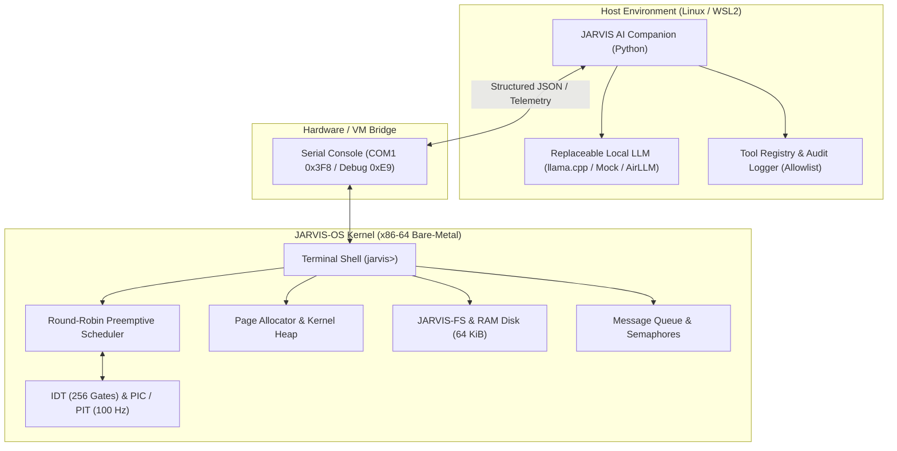

# JARVIS-OS — System Architecture

## 1. Overview and Core Philosophy

JARVIS-OS is structured as a modular educational operating system built on bare-metal x86-64 hardware, paired with a host-side AI companion.

The design strictly separates:
1. **Kernel Space (Ring 0)**: Freestanding C and Assembly responsible for CPU descriptor tables, page allocation, interrupt dispatching, task preemption, synchronization primitives, block storage, and the interactive terminal shell.
2. **Algorithm Simulators**: Clean, host-testable educational modules demonstrating classic OS algorithms with deterministic inputs.
3. **Host Environment**: External Python companion running on the host OS that communicates with the kernel environment via serial/console streams, hosting local LLM models (llama.cpp, AirLLM, or mock backends) and executing allowlisted tool requests.



---

## 2. Boot Sequence and CPU Initialization

### 2.1 Multiboot Hand-off and Long Mode Transition
1. **GRUB Stage**: GRUB loads `build/jarvis.bin` based on the Multiboot header in `kernel/arch/x86_64/boot.S`. GRUB supplies magic `0x2BADB002` in `%eax` and the physical address of the `multiboot_info_t` struct in `%ebx`.
2. **Protected Mode (`.code32`)**:
   - Preserves `%eax` and `%ebx` in kernel variables `multiboot_magic` and `multiboot_info_ptr` before registers are reused.
   - Disables CPU interrupts (`cli`).
   - Sets up initial 4-level paging structures (`pml4_table`, `pdpt_table`, `pd_table`).
   - Identity-maps the first 2 MiB of physical memory using a huge page (`0x83` flags: Present + Writable + Huge).
   - Loads `%cr3` with `pml4_table`.
   - Enables Physical Address Extension (PAE) by setting bit 5 in `%cr4`.
   - Enables Long Mode by setting the LME bit in the IA32_EFER MSR (`0xC0000080`).
   - Enables Paging and Protection by setting PG and PE bits in `%cr0`.
   - Loads the 64-bit Global Descriptor Table (`gdt_descriptor`).
   - Performs a long jump `ljmp $0x08, $long_mode_start` to enter 64-bit Long Mode.
3. **Long Mode Entry (`.code64`)**:
   - Reloads data segment registers (`%ds`, `%es`, `%ss`) with selector `0x10`.
   - Sets the kernel stack pointer to `stack_top` (16 KiB reserved stack).
   - Loads `multiboot_magic(%rip)` into `%rdi` and `multiboot_info_ptr(%rip)` into `%rsi` to satisfy the System V AMD64 calling convention.
   - Calls `kernel_main(magic, mb_info_addr)` in `kernel/kernel.c`.
4. **Early Debug & Memory Discovery**:
   - `debug_early_init()` configures COM1 and debug port `0xE9` before terminal or interrupt initialization, enabling crash reporting even if VGA fails.
   - `multiboot_init(magic, addr)` parses memory map tags, discovers physical RAM boundaries (e.g. 255 MiB in QEMU), and logs BIOS/GRUB memory map regions.

---

## 3. Interrupts, Exceptions, and Frame Correctness

### 3.1 Interrupt Descriptor Table (IDT) & Kernel Panic
- The IDT contains 256 16-byte gates loaded via `lidt`.
- CPU exception gates `0..31` are hooked to `generic_exception_stub` (with vector 14 routed to `page_fault_stub`). This ensures any CPU fault (such as #GP, #SS, or #UD) outputs diagnostic text, calls `kernel_panic`, and halts safely, preventing silent triple-faults.
- `kernel_panic(message)` disables interrupts, emits diagnostic messages to early serial/0xE9, reads `CR2`, `CR3`, and `RSP` registers, paints a high-contrast red alert banner to the VGA text buffer (`0xB8000`), and halts the CPU with `cli; hlt`.
- Vector `32` (IRQ0) is hooked to `timer_stub` for 100 Hz timer preemption.
- Vector `0x81` is hooked to `schedule_stub` for cooperative task yielding.

### 3.2 x86-64 Interrupt Frame Layout
In 64-bit Long Mode, the CPU **always** pushes 5 quadwords onto the stack during an interrupt or exception, regardless of whether a privilege transition occurs:

```
[RSP + 32]  SS      (Kernel Data Segment, 0x10)
[RSP + 24]  RSP     (Original Stack Pointer)
[RSP + 16]  RFLAGS  (Flags with Interrupt Enable, 0x202)
[RSP + 8]   CS      (Kernel Code Segment, 0x08)
[RSP + 0]   RIP     (Instruction Pointer)
```

The assembly stub macro `SAVE_REGISTERS` pushes 15 general-purpose registers:
`%rax, %rbx, %rcx, %rdx, %rbp, %rsi, %rdi, %r8, %r9, %r10, %r11, %r12, %r13, %r14, %r15` (120 bytes).

Thus, the saved interrupt frame contains exactly **20 quadwords (160 bytes)**:
- `frame[0..14]`: 15 GPRs (with `frame[8]` representing `%rdi`, used for thread argument passing)
- `frame[15]`: RIP
- `frame[16]`: CS (`0x08`)
- `frame[17]`: RFLAGS (`0x202`)
- `frame[18]`: RSP (Process stack top)
- `frame[19]`: SS (`0x10`)

When `RESTORE_REGISTERS` pops 15 quadwords, `%rsp` is positioned precisely at `frame[15]`, allowing `iretq` to pop all 5 hardware fields atomically.

---

## 4. Process & Thread Scheduling Architecture

### 4.1 Process Control Block (`process_t`) & Threads
Each process or thread is represented by a control block containing:
- Process ID (`pid`), thread state (`PROCESS_NEW`, `PROCESS_READY`, `PROCESS_RUNNING`, `PROCESS_BLOCKED`, `PROCESS_TERMINATED`), and priority.
- Target `wake_tick` for timer-driven sleep wakeups.
- Dedicated 4096-byte kernel stack (`process_stacks[i]`).
- Pointer to saved interrupt frame (`interrupt_frame`).
- `thread_create(entry_point, arg, priority)` initializes a thread sharing the kernel address space, placing `arg` directly into `%rdi` (`frame[8]`) according to the System V AMD64 ABI.
- `process_sleep(ticks)` sets `wake_tick = timer_ticks + ticks` and transitions the thread to `PROCESS_BLOCKED`.

### 4.2 Preemptive vs Cooperative Switching & Metrics
- **Cooperative**: A task invokes `scheduler_yield()`, which triggers software interrupt `int $0x81`. `schedule_stub` saves registers, invokes `scheduler_interrupt(frame, 0)`, updates state to `PROCESS_READY`, selects the next runnable task, and restores the new frame via `iretq`. Increments `voluntary_yields`.
- **Preemptive**: The PIT timer fires IRQ0 at 100 Hz. `timer_stub` increments `timer_ticks`, acknowledges the PIC (`pic_send_eoi(0)`), sweeps sleeping tasks to awaken those whose `wake_tick <= timer_ticks`, and checks quantum expiration (`SCHEDULER_RR_QUANTUM = 5` ticks by default, configurable via `scheduler_set_quantum`). Increments `quantum_preemptions`.
- **Instrumentation**: `scheduler_stats_t` tracks `context_switches`, `quantum_preemptions`, `voluntary_yields`, and `timer_ticks`, inspectable via shell commands `status`, `sched`, and `threads`.
- **Clean Bootstrap Return**: When all tasks terminate, the scheduler detects `next == 0` and restores `bootstrap_frame`, cleanly returning to `kernel_main` to launch the interactive shell.

---

## 5. Storage and Minimal Filesystem (JARVIS-FS)

JARVIS-FS provides educational file storage backed by a 64 KiB RAM disk (128 sectors of 512 bytes):
- **Sector 0**: Superblock (`magic = 0x4A415256`, block count, free block count) + Block Allocation Bitmap.
- **Sectors 1..3**: Inode Table (16 inodes, each with filename, size, and 8 direct block pointers).
- **Sectors 4..127**: 120 Data Blocks (512 bytes each).
- **Default Files**: `fs_init()` formats the disk and creates `kernel.cfg` populated with system configuration parameters (`OS=JARVIS-OS`, `VERSION=1.0-PHASE2`, `QUANTUM=5`, `SCHEDULER=ROUND_ROBIN`).
- Standard operations implemented: `fs_format()`, `fs_create()`, `fs_open()`, `fs_read()`, `fs_write()`, `fs_close()`, `fs_delete()`, and directory listing `fs_list()`. Active file descriptors pointing to deleted inodes are automatically invalidated.
- Shell commands: `ls` (lists file table with sizes and block counts), `cat <filename>` (reads and prints file contents directly to console).

---

## 6. Console I/O Architecture

To support interactive use and automated smoke testing without external display dependencies:
- **Output**: `terminal_putchar` simultaneously writes characters to:
  1. The VGA text buffer at physical address `0xB8000` (for graphical QEMU/Bochs windows).
  2. The COM1 serial port at I/O port `0x3F8` (configured at 38400 baud, 8N1).
  3. The QEMU/Bochs debug port at I/O port `0xE9`.
- **Input**: `keyboard_read_char` polls both the COM1 serial status register (`0x3FD & 0x01`) and the PS/2 keyboard controller (`0x64 & 0x01`). Keystrokes typed into either the graphical window or a piped terminal session are handled identically.

---

## 7. System Call Entry Architecture (`int $0x80`)

The system call infrastructure provides a clean interrupt-driven gateway into kernel services:
- **Invocation**: User-level or diagnostic code invokes software interrupt `int $0x80` with `%rax` set to the system call number, and `%rdi`, `%rsi`, `%rdx` containing arguments.
- **IDT Gate**: Vector `0x80` is configured with Descriptor Privilege Level 3 (`0xEE`), permitting invocation from software interrupts.
- **Assembly Stub (`syscall_stub`)**:
  1. Macro `SAVE_REGISTERS` pushes all 15 GPRs to form the standard interrupt frame.
  2. Extracts parameters from the stack frame:
     - `112(%rsp)`: Syscall number (saved `rax`) -> `%rdi`
     - `64(%rsp)`: Arg 1 (saved `rdi`) -> `%rsi`
     - `72(%rsp)`: Arg 2 (saved `rsi`) -> `%rdx`
     - `88(%rsp)`: Arg 3 (saved `rdx`) -> `%rcx`
  3. Calls `syscall_dispatch(%rdi, %rsi, %rdx, %rcx)` with 16-byte stack alignment.
  4. Writes return value in `%rax` back to `112(%rsp)` on the stack.
  5. `RESTORE_REGISTERS` pops all registers and executes `iretq`.
- **Dispatcher (`syscall_dispatch`)**: Validates the system call number against `SYSCALL_MAX` and dispatches to kernel service routines (`SYS_GET_TICKS`, `SYS_ALLOCATE_MEMORY`, `SYS_FREE_MEMORY`, `SYS_CREATE_PROCESS`, `SYS_GET_PROCESS_COUNT`, `SYS_TERMINATE_PROCESS`).

---

## 8. Educational Algorithm Subsystems

The operating system includes deterministic educational simulators for key computer science concepts:
1. **Memory Allocation Strategies (`kernel/algorithms/mem_fit.c`)**: First Fit, Best Fit, and Worst Fit algorithms calculating block assignments, remaining partition holes, and external fragmentation.
2. **File Allocation Methods (`kernel/algorithms/file_alloc.c`)**: Contiguous, Linked, and Indexed allocation simulators comparing access speed ($O(1)$ vs $O(N)$), overhead, and fragmentation.
3. **Deadlock Management (`kernel/algorithms/banker.c`, `deadlock.c`)**:
   - Avoidance: Dijkstra's Banker's algorithm computing Need matrices and safe execution sequences.
   - Detection: Matrix and Wait-For Graph (WFG) cycle detection identifying deadlocked process sets.
   - Prevention: Havender's global linear resource hierarchy preventing circular wait conditions.

