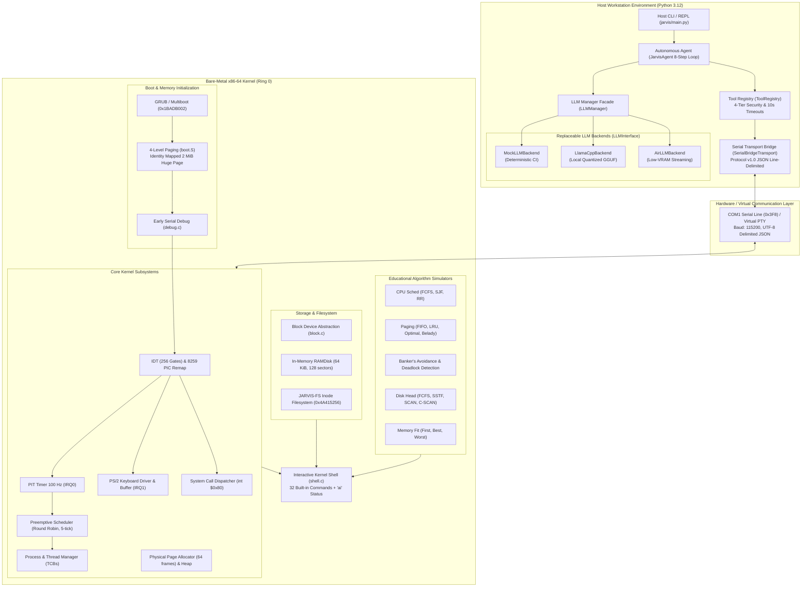
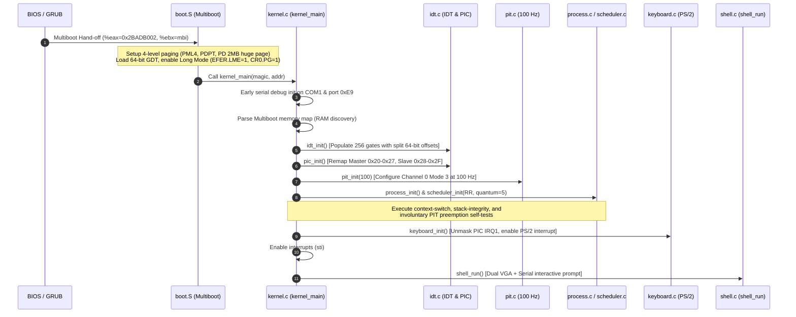
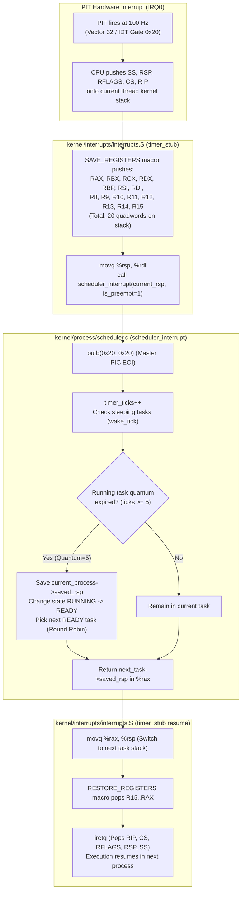
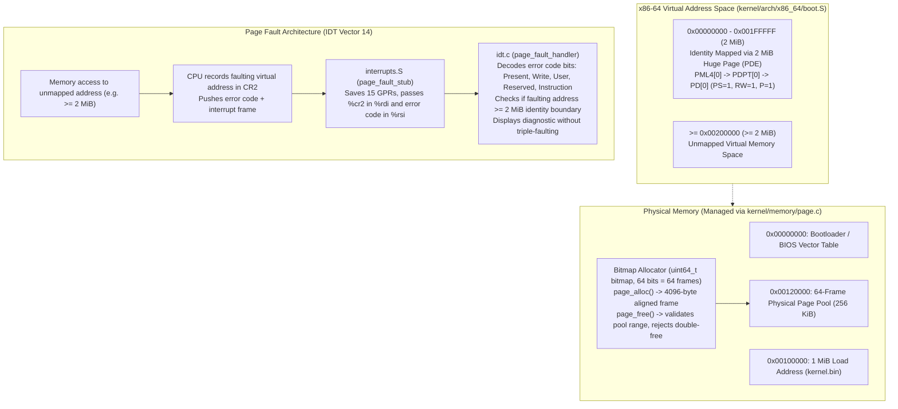
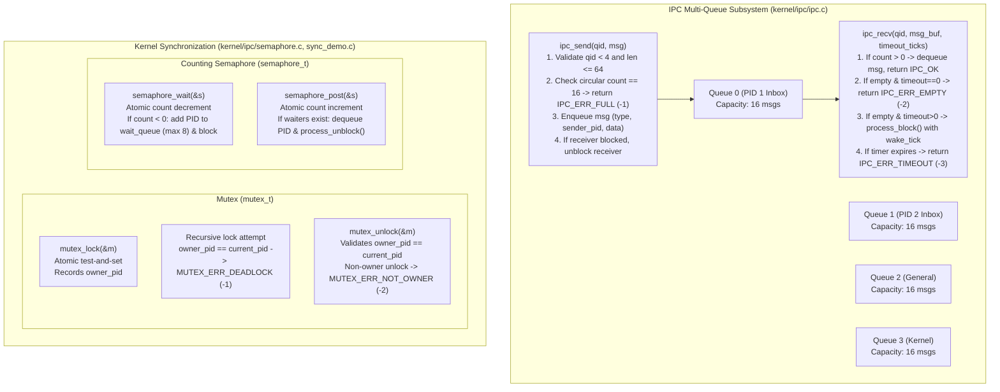
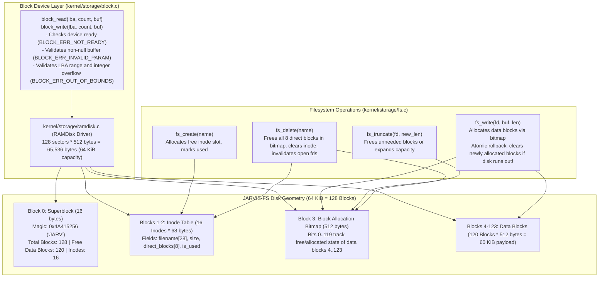
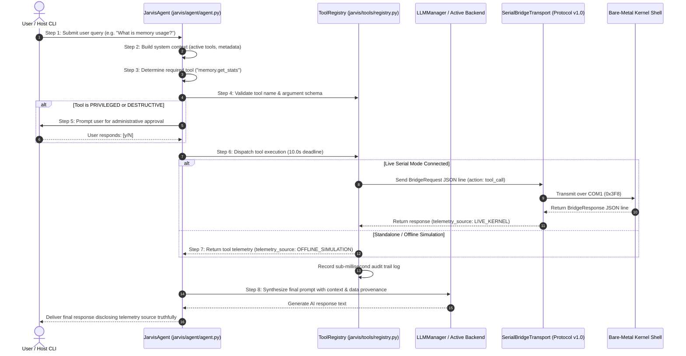

# JARVIS-OS — System Architecture Diagrams

This document contains editable, source-controlled Mermaid diagrams representing the exact architectural implementation of JARVIS-OS across its bare-metal x86-64 kernel and host-side AI assistant companion.

---

## 1. Overall System Architecture

The following diagram illustrates the relationship between the bare-metal x86-64 kernel environment (executing inside QEMU / hardware) and the host-side local AI companion service, bridged via serial line transport (COM1 / `0x3F8`):

---

## 2. Boot and Interrupt Subsystem Flow

This sequence diagram depicts the boot execution path from BIOS/GRUB hand-off to the unmasking of hardware interrupts and shell launch:

---

## 3. Process Scheduling & Preemptive Context Switching

The context-switching mechanism relies on a 20-quadword stack frame restoring all 15 general-purpose registers and executing an architectural `iretq`:

---

## 4. Memory Management & Page-Fault Architecture

The memory subsystem cleanly separates physical bitmap frame allocation from identity-mapped virtual paging and safe fault diagnostics:

---

## 5. IPC Multi-Queue & Synchronization Primitives

The IPC subsystem implements multi-queue message routing with boundary protection, while synchronization provides counting semaphores and mutexes with ownership tracking:

---

## 6. Storage & Resilient Filesystem (JARVIS-FS)

JARVIS-FS provides a hardened inode-based filesystem built on top of a clean block-device abstraction:

---

## 7. AI Companion, Tool Registry & Eight-Step Agent Loop

The host-side AI assistant executes an 8-step agentic cycle mediated by a 4-tier security allowlist:

