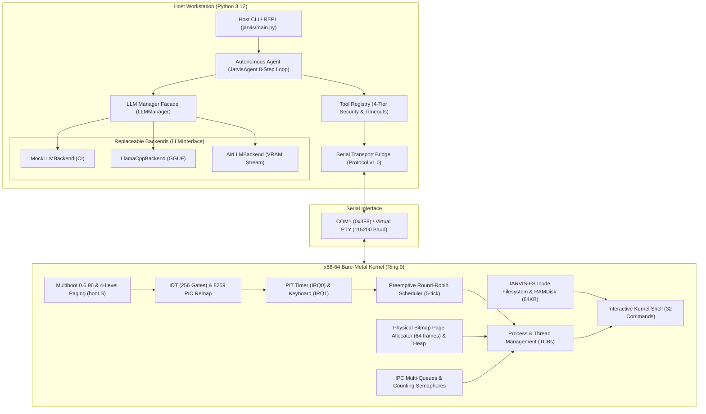

# JARVIS-OS — Final Technical Project Report

**Project Title:** JARVIS-OS: An Educational x86-64 Operating System with an Offline Replaceable AI Assistant Architecture  
**Author:** Antigravity AI & JARVIS-OS Engineering Team  
**Repository:** `https://github.com/kuntalsaha05/jarvis-os`  
**Milestone:** Phase 8 Final Delivery  
**Target:** Bare-Metal x86-64 Kernel (Long Mode) + Host-Side Local AI Assistant  
**Date:** 2026-10-18  

---

## 1. Abstract and Problem Statement

Modern operating systems are complex software artifacts that abstract heterogeneous hardware, schedule compute resources, manage virtual memory, arbitrate concurrent tasks, and provide persistent hierarchical storage. However, contemporary production operating systems (such as Linux, Windows, and Darwin) contain millions of lines of code, heavily obfuscating foundational systems principles behind optimizations and driver stacks. Conversely, simplified pedagogical operating systems often either remain 32-bit legacy kernels, rely exclusively on simulated userspace runtimes, or lack modern intelligence primitives.

Furthermore, integrating large language models (LLMs) and artificial intelligence assistants into system software is typically achieved by treating system diagnostics as opaque text prompts dispatched to cloud APIs. This presents severe privacy, latency, and security challenges, including the absence of sandboxed execution, failure to enforce explicit user consent for destructive operations, and misleading claims regarding live vs simulated hardware telemetry.

**JARVIS-OS solves these challenges by delivering:**
1. A genuine, bootable, freestanding x86-64 operating system built from scratch in C and assembly, running in 64-bit Long Mode via GRUB/Multiboot.
2. Involuntary preemptive multitasking without cooperative yields, supported by a 100 Hz PIT timer, 256-gate IDT, 8259 PIC remap, and System V AMD64 calling convention stack frames.
3. A resilient in-memory filesystem (JARVIS-FS) with atomic block rollback, truncation, and block-device abstraction.
4. Classical textbook OS algorithms implemented as decoupled, mathematically verified educational demonstrators (CPU scheduling, page replacement & Belady's anomaly, Banker's deadlock avoidance, memory fitting, and disk scheduling).
5. A local-first, replaceable host AI companion architecture operating across a versioned line-delimited serial bridge, featuring an 8-step agentic loop, a 4-tier security sandbox with explicit user confirmation, 10-second execution deadlines, and sub-millisecond audit trails.

---

## 2. Objectives and Project Scope

The core objective of JARVIS-OS is to construct a bootable educational operating system that demonstrates core system mechanisms alongside an autonomous, secure AI assistant.

### 2.1 Four Architectural Pillars:
1. **Real Kernel Mechanisms (Ring 0)**:
   - GRUB Multiboot 0.6.96 hand-off, 64-bit GDT, 4-level paging (PML4, PDPT, PDE 2 MiB huge page).
   - Interrupt handling: 32 CPU exceptions, PIT timer IRQ0 (100 Hz), PS/2 keyboard IRQ1 (Vector 33).
   - Preemptive Round-Robin scheduler (5-tick quantum) and software interrupt system call mechanism (`int $0x80`).
   - Physical bitmap frame allocator (64 frames of 4096 bytes) and kernel heap.
   - IPC bounded message multi-queues (4 isolated queues) and counting semaphores with atomic wakeups.
   - RAM disk driver (64 KiB) and JARVIS-FS inode filesystem with allocation rollback.

2. **Host-Side Intelligence & Tool Registry**:
   - `LLMInterface` abstract base class supporting `MockLLMBackend` (deterministic CI), `LlamaCppBackend` (quantized local GGUF), and `AirLLMBackend` (low-VRAM layer streaming).
   - Four-tier security allowlist (`READ_ONLY`, `SAFE_DIAGNOSTIC`, `PRIVILEGED`, `DESTRUCTIVE`).
   - Explicit user authorization gating for privileged (`system.trigger_panic`) and destructive (`storage.format_disk`) tools.
   - Line-delimited serial transport (Protocol v1.0) with strict data provenance labeling (`LIVE_KERNEL` vs `OFFLINE_SIMULATION`).

3. **Educational Algorithm Simulators**:
   - Cleanly separated from native hardware routines to teach theoretical concepts without obscuring real kernel mechanisms:
     - CPU Scheduling: FCFS, SJF, and Round Robin turnaround/wait calculations.
     - Page Replacement: FIFO, LRU, Optimal, and Belady's anomaly (9 vs 10 faults).
     - Deadlock: Banker's safety sequence, WFG/Matrix cycle detection, Havender global ordering.
     - Memory Partition Fit: First Fit, Best Fit, and Worst Fit external fragmentation.
     - Disk Head Scheduling: FCFS, SSTF, SCAN (Elevator), and C-SCAN seek calculations.

4. **Architectural Boundaries (Conscious Scope)**:
   - Single-privilege monolith: all kernel threads and shell execute in Ring 0.
   - Uniprocessor PIC model (SMP/APIC is outside educational scope).
   - Volatile in-memory storage: RAM disk resets upon machine reboot.

---

## 3. System Architecture

The architecture bridges the host machine intelligence and the bare-metal kernel guest:



---

## 4. Hardware and Software Requirements

### 4.1 Host System Requirements
- **Operating System**: Linux (Debian/Ubuntu, Fedora, or Arch).
- **Toolchains**:
  - `gcc` (Host C compilation for unit tests).
  - `x86_64-elf-gcc` (Freestanding cross-compiler for kernel source).
  - `x86_64-elf-ld` (ELF64 cross-linker).
  - `nasm` / GNU `as` (x86-64 assembly).
  - `xorriso`, `grub-mkrescue` (Bootable ISO creation).
  - `qemu-system-x86_64` (Emulator with serial stdio).
  - `python3` (Version $\ge$ 3.10).

### 4.2 Target Hardware Profile
- **Architecture**: AMD64 / Intel 64 (x86-64).
- **RAM**: Minimum 256 MiB (QEMU parameter `-m 256M`).
- **Interrupt Controller**: Standard dual 8259 PIC.
- **Timer**: 8254 Programmable Interval Timer (PIT) at 100 Hz.
- **Console / Display**: Dual-mode output — standard 80x25 VGA text buffer (`0xB8000`), 16550A UART COM1 (`0x3F8`), and Bochs/QEMU debug port (`0xE9`).
- **Input**: Dual-mode input — standard PS/2 keyboard controller (`0x60`/`0x64`) and COM1 serial line.

---

## 5. Boot Process and Interrupt Architecture

### 5.1 Boot Sequence
1. **Multiboot Hand-off**: GRUB loads `build/jarvis.bin` at physical address `0x00100000` (1 MiB), verifying Multiboot header magic `0x1BADB002`. Register `%eax` contains `0x2BADB002` and `%ebx` holds the pointer to the Multiboot Information structure (`multiboot_info_t`).
2. **Long Mode Bootstrap ([`kernel/arch/x86_64/boot.S`](file:///home/kuntalsaha/jarvis-os/kernel/arch/x86_64/boot.S))**:
   - Allocates 4-level paging structures in BSS: PML4, PDPT, and Page Directory (PD).
   - Configures an identity-mapped 2 MiB huge page (`0x00000000 - 0x001FFFFF`) with Present and Writable flags (`0x83`).
   - Loads CR3 with PML4 base address, sets PAE bit in CR4 (`CR4.PAE = 1`), enables Long Mode in EFER MSR (`IA32_EFER.LME = 1`), and enables Paging in CR0 (`CR0.PG = 1`).
   - Loads a 64-bit Global Descriptor Table (GDT) with Code Selector `0x08` and Data Selector `0x10`.
   - Executes `ljmp $0x08, $long_mode_start` to enter 64-bit Long Mode.

### 5.2 Interrupt Subsystem ([`kernel/interrupts/`](file:///home/kuntalsaha/jarvis-os/kernel/interrupts/))
- **IDT Structure**: Full 256-entry table. Each gate descriptor splits the 64-bit offset into `offset_low` (bits 0–15), `offset_middle` (bits 16–31), and `offset_high` (bits 32–63) with selector `0x08` and type attributes `0x8E` (Interrupt Gate, Ring 0) or `0xEE` (Ring 3 callable for `int $0x80`).
- **PIC Remap**: Master PIC offsets remapped from vectors 0–7 to 32–39 (`0x20`), and Slave PIC from 8–15 to 40–47 (`0x28`).
- **PIT Timer (IRQ0, Vector 32)**: Configured at 100 Hz (10 ms period). The ISR issues PIC EOI (`outb(0x20, 0x20)`), increments `timer_ticks`, sweeps sleeping tasks, and enforces Round-Robin quantum preemption.
- **PS/2 Keyboard (IRQ1, Vector 33)**: Unmasked in the Master PIC. When a key is pressed, `keyboard_handler` reads port `0x60`, buffers the scancode in a circular queue, sends EOI, and returns. The shell processes scancodes asynchronously outside the ISR.
- **Page Fault Handler (`#PF`, Vector 14)**: Reads CR2 into `%rdi` and error code into `%rsi`. Decodes Present (P), Write/Read (W/R), User/Supervisor (U/S), and Reserved (RSVD) bits, diagnosing access violations beyond the 2 MiB identity boundary without crashing.

---

## 6. Process Management and Scheduling

### 6.1 Process Control Blocks (TCB) & Lifecycle
Defined in [`kernel/process/process.h`](file:///home/kuntalsaha/jarvis-os/kernel/process/process.h):
- States: `PROCESS_NEW`, `PROCESS_READY`, `PROCESS_RUNNING`, `PROCESS_BLOCKED`, `PROCESS_TERMINATED`.
- Valid transitions are strictly enforced via `process_is_valid_transition()`.
- Thread Model: `thread_create(entry_point, arg, priority)` spawns kernel threads sharing the address space, allocating a dedicated 4 KiB stack and passing `arg` in register `%rdi` conforming to the System V AMD64 ABI.
- Dedicated Idle Task (PID 0): Runs at lowest priority executing `sti; hlt` whenever all user tasks block, preventing CPU starvation.

### 6.2 Preemptive Context Switching
- Involuntary preemption is executed via the PIT timer (default quantum = 5 ticks = 50 ms).
- **Exact 20-Quadword Stack Frame**:
  ```
  [RSP + 152] SS (0x10)
  [RSP + 144] RSP (Task Stack Top, 16-byte aligned)
  [RSP + 136] RFLAGS (0x202, Interrupts Enabled)
  [RSP + 128] CS (0x08)
  [RSP + 120] RIP (Task Entry / Trampoline)
  [RSP + 112] RAX
  [RSP + 104] RBX
  [RSP +  96] RCX
  [RSP +  88] RDX
  [RSP +  80] RBP
  [RSP +  72] RSI
  [RSP +  64] RDI (Argument 'arg')
  [RSP +  56] R8
  [RSP +  48] R9
  [RSP +  40] R10
  [RSP +  32] R11
  [RSP +  24] R12
  [RSP +  16] R13
  [RSP +   8] R14
  [RSP +   0] R15
  ```
- Resuming execution switches `%rsp` to the target task frame and executes `RESTORE_REGISTERS` followed by architectural `iretq`.
- Cooperative yielding is supported via `int $0x81`.

---

## 7. Memory Management and Page Replacement

### 7.1 Physical Page Allocator ([`kernel/memory/page.c`](file:///home/kuntalsaha/jarvis-os/kernel/memory/page.c))
- Bitmap allocator managing a static pool of 64 physical 4096-byte pages (256 KiB capacity).
- Enforces strict pool range checks (`pool_base` to `pool_end`), 4096-byte alignment, and double-free protection.
- Heap Allocator ([`kernel/memory/heap.c`](file:///home/kuntalsaha/jarvis-os/kernel/memory/heap.c)): 64 KiB kernel heap for dynamic data structures with boundary tags.

### 7.2 Educational Page Replacement Simulators ([`kernel/algorithms/page_replace.c`](file:///home/kuntalsaha/jarvis-os/kernel/algorithms/page_replace.c))
- Mathematical simulation comparing FIFO, LRU, and Optimal page replacement across standardized reference strings.
- **Belady's Anomaly**: Deterministic demonstration using reference string `1, 2, 3, 4, 1, 2, 5, 1, 2, 3, 4, 5`:
  - 3 frames $\to$ 9 page faults.
  - 4 frames $\to$ 10 page faults.
  - Formally proves that increasing allocation in FIFO replacement can paradoxically increase faults.

### 7.3 Dynamic Memory Fit Simulator ([`kernel/algorithms/mem_fit.c`](file:///home/kuntalsaha/jarvis-os/kernel/algorithms/mem_fit.c))
- Evaluates First Fit, Best Fit, and Worst Fit allocation strategies across variable-sized memory requests, tracking external fragmentation.

---

## 8. IPC, Synchronization, and Deadlocks

### 8.1 Multi-Queue IPC Subsystem ([`kernel/ipc/ipc.c`](file:///home/kuntalsaha/jarvis-os/kernel/ipc/ipc.c))
- 4 isolated bounded queues (`IPC_MAX_QUEUES = 4`).
- Bounded capacity: 16 messages per queue, 64-byte payload.
- Error codes:
  - `IPC_ERR_FULL` (-1): Rejects write on queue saturation.
  - `IPC_ERR_EMPTY` (-2): Returns immediately on non-blocking receive.
  - `IPC_ERR_TIMEOUT` (-3): Returned when scheduler-integrated sleep expires before a message arrives.

### 8.2 Synchronization Primitives ([`kernel/ipc/`](file:///home/kuntalsaha/jarvis-os/kernel/ipc/))
- **Counting Semaphores ([`semaphore.c`](file:///home/kuntalsaha/jarvis-os/kernel/ipc/semaphore.c))**: `semaphore_init`, `semaphore_wait`, `semaphore_try_wait`, `semaphore_post`. Uses atomic built-ins and 8-task wait queues.
- **Mutex Locks with Ownership Tracking ([`sync_demo.c`](file:///home/kuntalsaha/jarvis-os/kernel/ipc/sync_demo.c))**:
  - Mutexes record `owner_pid`.
  - Non-owner unlock attempts return `MUTEX_ERR_NOT_OWNER` (-2) and leave the lock held.
  - Recursive locking returns `MUTEX_ERR_DEADLOCK` (-1) to actively prevent self-deadlocks.
- Classic Demonstrations: Producer-Consumer bounded buffer (capacity 4) and Reader-Writer problem (concurrent readers, exclusive writer).

### 8.3 Deadlock Algorithms ([`kernel/algorithms/`](file:///home/kuntalsaha/jarvis-os/kernel/algorithms/))
- **Banker's Algorithm ([`banker.c`](file:///home/kuntalsaha/jarvis-os/kernel/algorithms/banker.c))**: 5 processes, 3 resource types. Evaluates Allocation, Max, Need, and Available matrices. Computes safe sequence `<P1 -> P3 -> P4 -> P0 -> P2>`.
- **Deadlock Detection & Prevention ([`deadlock.c`](file:///home/kuntalsaha/jarvis-os/kernel/algorithms/deadlock.c))**: Wait-For Graph cycle detection and Havender's global resource ordering prevention.

---

## 9. Storage, Filesystem, and Disk Scheduling

### 9.1 Block Device Abstraction & RAM Disk ([`kernel/storage/`](file:///home/kuntalsaha/jarvis-os/kernel/storage/))
- Abstraction in [`block.c`](file:///home/kuntalsaha/jarvis-os/kernel/storage/block.c) provides bounds-checked sector read/write operations.
- Backing device: RAMDisk in [`ramdisk.c`](file:///home/kuntalsaha/jarvis-os/kernel/storage/ramdisk.c) with 128 sectors of 512 bytes (64 KiB total capacity).

### 9.2 JARVIS-FS Resilient Inode Filesystem ([`fs.c`](file:///home/kuntalsaha/jarvis-os/kernel/storage/fs.c))
- **Disk Geometry**:
  - Block 0: Superblock (magic `0x4A415256` "JARV", total blocks 128, free blocks 120, inodes 16).
  - Blocks 1–2: Inode table (16 inodes, 68 bytes each, 8 direct block pointers).
  - Block 3: Block allocation bitmap (bits 0..119 track data blocks 4..123).
  - Blocks 4–123: Data blocks (120 blocks $\times$ 512 bytes = 60 KiB).
- **Hardened Resilience**:
  - Atomic block allocation rollback on partial failure.
  - File truncation (`trunc`) reclaims direct blocks.
  - File deletion clears inode and direct blocks, invalidating open file descriptors.
  - Path normalization strips leading slashes.
- **Host Disk Utility ([`scripts/jarvis_fs_tool.py`](file:///home/kuntalsaha/jarvis-os/scripts/jarvis_fs_tool.py))**: Formats, inspects, and injects files into disk images on the host workstation.

### 9.3 File Allocation & Disk Scheduling Simulators
- File Allocation ([`file_alloc.c`](file:///home/kuntalsaha/jarvis-os/kernel/algorithms/file_alloc.c)): Contiguous, Linked, and Indexed block allocation comparisons.
- Disk Scheduling ([`disk_sched.c`](file:///home/kuntalsaha/jarvis-os/kernel/algorithms/disk_sched.c)): Compares cylinder movements across FCFS (640), SSTF (236), SCAN (331), and C-SCAN (382).

---

## 10. AI Companion, Local LLM Backends, and Tool Registry

### 10.1 Pluggable LLM Backend Architecture ([`jarvis/llm/`](file:///home/kuntalsaha/jarvis-os/jarvis/llm/))
- `LLMInterface`: Abstract base class providing `generate`, `generate_stream`, `chat`, `model_info`, and `health_check`.
- **`MockLLMBackend`**: Deterministic test backend with simulated streaming and simulated timeout triggers.
- **`LlamaCppBackend`**: Quantized GGUF model adapter via `llama-cpp-python`. Graceful fallback reporting missing weights or dependencies.
- **`AirLLMBackend`**: Low-VRAM 70B layer streaming adapter via `airllm`. Graceful fallback reporting GPU/CUDA prerequisites.

### 10.2 Four-Tier Security Tool Registry ([`jarvis/tools/registry.py`](file:///home/kuntalsaha/jarvis-os/jarvis/tools/registry.py))
- `READ_ONLY`: `kernel.query_status`, `memory.get_stats`, `scheduler.get_state`, `storage.list_files`, `storage.read_file`.
- `SAFE_DIAGNOSTIC`: `system.execute_algorithm_demo`.
- `PRIVILEGED`: `system.trigger_panic` (Gated by explicit user confirmation).
- `DESTRUCTIVE`: `storage.format_disk` (Gated by explicit user confirmation).
- Enforcement: Execution bounded by 10.0-second deadline; parameter type schema checking; timestamped audit log.

### 10.3 Eight-Step Autonomous Agent Loop ([`jarvis/agent/agent.py`](file:///home/kuntalsaha/jarvis-os/jarvis/agent/agent.py))
Executes structured cycle: Accept request $\to$ build context $\to$ determine tool $\to$ validate schema $\to$ request approval $\to$ execute safely $\to$ return telemetry $\to$ produce final response disclosing data provenance.

---

## 11. Kernel-Companion Communication & Protocol v1.0

Defined in [`jarvis/bridge/protocol.py`](file:///home/kuntalsaha/jarvis-os/jarvis/bridge/protocol.py) and [`jarvis/bridge/serial_transport.py`](file:///home/kuntalsaha/jarvis-os/jarvis/bridge/serial_transport.py):
- **Framing**: UTF-8 line-delimited JSON (`\n`) over COM1 serial line (`0x3F8`) or virtual PTY.
- **Strict Data Provenance**:
  - Live serial responses from the guest kernel: `"telemetry_source": "LIVE_KERNEL"`.
  - Host test or offline fallback responses: `"telemetry_source": "OFFLINE_SIMULATION"`.
  - The agent never represents offline simulation data as live hardware telemetry.

---

## 12. Testing Methodology and Actual Results

JARVIS-OS employs an automated four-tier test pyramid:

| Tier | Test Suite | Command | Checkpoints / Tests | Result | Execution Time |
| :---: | :--- | :--- | :---: | :---: | :---: |
| **1** | **Host C Algorithm Unit Tests** | `make test` | 15 test suites | **PASS** | 0.04s |
| **2** | **Python AI & Agent Tests** | `make test-ai` | 18 unit tests | **PASS** | 0.02s |
| **3** | **QEMU Bare-Metal Smoke Test** | `make test-qemu` | 65 checkpoints | **PASS** | 12.01s |
| **4** | **13-Step Release Validation** | `make test-release` | 13 full steps | **PASS** | 18.49s |
| **$\Sigma$** | **Unified Regression Suite** | `make test-all` | **All 4 Tiers** | **PASS** | **31.25s** |

---

## 13. Known Limitations and Future Improvements

In accordance with academic honesty, the following architectural boundaries are formally documented:
1. **Ring 0 Monolithic Kernel**: User processes execute in Ring 0 sharing the kernel address space. A true Ring 3 boundary requires TSS loading (`ltr`), separate user/supervisor page tables, and ELF64 user loading.
2. **Uniprocessor Architecture**: The kernel targets a single CPU core using legacy 8259 PIC. SMP, APIC/x2APIC, and inter-processor interrupts (IPIs) are planned future work.
3. **RAM Disk Volatility**: Storage is in-memory (64 KiB) and resets upon emulator termination. Real AHCI/NVMe drivers are future roadmap items.
4. **Host-Side Intelligence**: Deep learning inference executes host-side because freestanding bare-metal x86-64 environments lack floating-point CUDA/AVX runtimes.

---

## 14. Conclusion and References

JARVIS-OS successfully accomplishes its mission of delivering a complete, reproducible, freestanding x86-64 operating system coupled with an offline, replaceable AI assistant. By maintaining strict separation between real kernel mechanisms, educational algorithm simulators, and host-side AI inference, the project achieves textbook clarity without sacrificing bare-metal authenticity.

### Primary References:
1. Intel 64 and IA-32 Architectures Software Developer’s Manual, Volume 3A: System Programming Guide.
2. Silberschatz, A., Galvin, P. B., & Gagne, G. *Operating System Concepts* (10th ed.). Wiley.
3. Tanenbaum, A. S., & Bos, H. *Modern Operating Systems* (4th ed.). Pearson.
4. Multiboot Specification version 0.6.96 (Free Software Foundation).
5. System V Application Binary Interface: AMD64 Architecture Processor Supplement.

