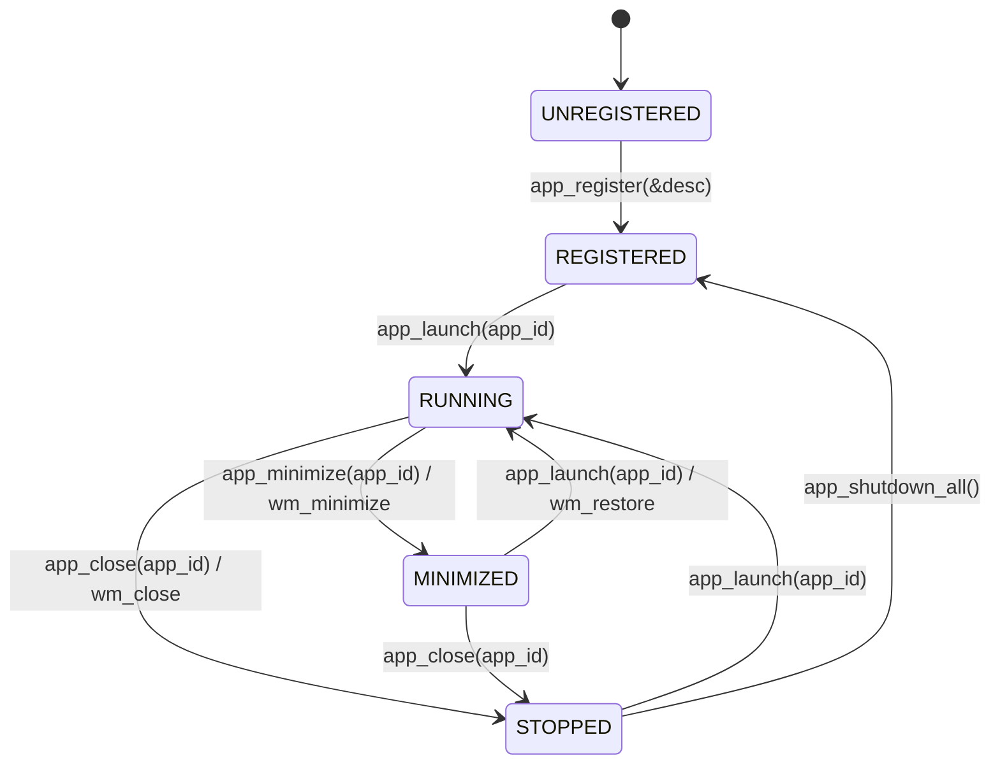

# JARVIS-OS — Phase 12: Application Framework and Desktop Persistence Report

**Milestone**: Phase 12 — Reusable GUI Application Framework, Desktop Configuration & Persistence Subsystem  
**Date**: October 2026  
**Architecture**: x86-64 Long Mode Bare-Metal Kernel + Host AI Companion  
**Display Mode**: VBE / Bochs BGA $1024 \times 768 \times 32\text{ bpp}$ Linear Framebuffer (`0xFD000000`)

---

## 1. Executive Summary

Phase 12 transitions JARVIS-OS from ad-hoc GUI window management into a **modular, reusable Application Framework (`app.c` / `app.h`)** and a **versioned, validated Desktop Configuration and Persistence Subsystem (`config.c` / `config.h`)**.

All desktop applications—Terminal, System Monitor, File Browser, Process Monitor, and JARVIS AI Companion—have been refactored as formal framework applications registering descriptors with distinct lifecycle callbacks (`init`, `render`, `handle_key`, `handle_click`, `shutdown`). Window creation, event bridging, theme styling, and resource cleanup are decoupled from application logic.

Additionally, desktop settings (themes, accent colors, taskbar visibility and position, startup applications) are serialized to `/desktop.cfg` with magic header verification (`0x4A434647`), schema versioning, and 32-bit polynomial checksum integrity checking.

---

## 2. Application Framework Architecture ([`kernel/gui/app.c`](file:///home/kuntalsaha/jarvis-os/kernel/gui/app.c) / [`kernel/gui/app.h`](file:///home/kuntalsaha/jarvis-os/kernel/gui/app.h))

### 2.1 Application Lifecycle State Machine

Applications in JARVIS-OS follow a bounded lifecycle model:



### 2.2 Application Descriptor (`app_desc_t`)

Applications declare their capabilities and callbacks via a structured descriptor:

```c
typedef struct {
    uint32_t app_id;               /* Unique numeric ID (e.g., APP_ID_TERMINAL) */
    char name[64];                 /* Human-readable title */
    char category[24];             /* Category: "System", "Utilities", "AI" */
    char icon_label[16];           /* Taskbar shortcut label (e.g., "[TERM]") */
    int32_t default_x;             /* Initial X position */
    int32_t default_y;             /* Initial Y position */
    uint32_t default_w;            /* Initial window width */
    uint32_t default_h;            /* Initial window height */
    window_type_t win_type;        /* Window Manager canvas category */

    int (*init)(void *app_ctx);
    void (*render)(void *app_ctx, window_t *win, int is_focused);
    void (*handle_key)(void *app_ctx, window_t *win, char c);
    void (*handle_click)(void *app_ctx, window_t *win, int32_t rx, int32_t ry, uint8_t buttons);
    void (*shutdown)(void *app_ctx);
} app_desc_t;
```

### 2.3 Registry Guarantees

1. **Bounded Static Allocation**: An internal registry of `MAX_REGISTERED_APPS = 16` preallocated slots eliminates dynamic heap allocation during application registration.
2. **Duplicate ID Rejection**: `app_register` verifies uniqueness; attempts to register an already existing `app_id` fail with `APP_ERR_DUPLICATE_ID`.
3. **Decoupled Window Manager Bridge**: When `app_launch` is invoked:
   - A window is allocated via `wm_create_window()`.
   - Window callbacks (`render_content`, `handle_key`, `handle_click`) are automatically bridged to the application descriptor.
   - Closing the window in the WM triggers `app_close()`, ensuring clean shutdown and freeing of window resources.

---

## 3. Desktop Configuration & Persistence Subsystem ([`kernel/gui/config.c`](file:///home/kuntalsaha/jarvis-os/kernel/gui/config.c) / [`kernel/gui/config.h`](file:///home/kuntalsaha/jarvis-os/kernel/gui/config.h))

### 3.1 Binary Configuration Format (`desktop.cfg`)

The desktop configuration is serialized in a fixed 52-byte binary block with integer fields and integrity protection:

| Offset | Field | Type | Description |
|---|---|---|---|
| 0x00 | `magic` | `uint32_t` | Magic signature `0x4A434647` (`"JCFG"`) |
| 0x04 | `version` | `uint32_t` | Configuration schema version (`1`) |
| 0x08 | `screen_width` | `uint32_t` | Screen width ($1024\text{ px}$) |
| 0x0C | `screen_height` | `uint32_t` | Screen height ($768\text{ px}$) |
| 0x10 | `bpp` | `uint32_t` | Color depth ($32\text{ bpp}$) |
| 0x14 | `color_desktop_bg` | `uint32_t` | 0x00RRGGBB Desktop background |
| 0x18 | `color_panel_bg` | `uint32_t` | 0x00RRGGBB Taskbar/panel background |
| 0x1C | `color_accent` | `uint32_t` | 0x00RRGGBB Active window border / accent |
| 0x20 | `theme_id` | `uint32_t` | Selected theme ID ($0..2$) |
| 0x24 | `taskbar_visible` | `uint32_t` | `1` = visible, `0` = hidden |
| 0x28 | `taskbar_position` | `uint32_t` | `0` = bottom, `1` = top |
| 0x2C | `startup_apps_mask` | `uint32_t` | Bitmask of applications to launch at boot |
| 0x30 | `checksum` | `uint32_t` | 32-bit polynomial checksum across offsets `0x00..0x2C` |

### 3.2 Themes & Appearance

JARVIS-OS features 3 switchable desktop themes accessible via shortcut key `T` or programmatic configuration:

1. **JARVIS Dark (Default)**:
   - Desktop BG: `0x000F172A` (Midnight Slate)
   - Panel BG: `0x001E293B` (Dark Steel)
   - Accent: `0x0038BDF8` (JARVIS Cyan)
2. **Cyberpunk**:
   - Desktop BG: `0x000D0221` (Deep Violet)
   - Panel BG: `0x001B053A` (Dark Neon Purple)
   - Accent: `0x00FF007F` (Electric Magenta)
3. **Classic Slate**:
   - Desktop BG: `0x002B3A42` (Classic Slate Grey)
   - Panel BG: `0x001F292E` (Charcoal)
   - Accent: `0x004CAF50` (Terminal Emerald)

### 3.3 Persistence Honesty & Storage Guarantees

> [!IMPORTANT]
> **Persistence Evaluation (Honesty Declaration)**:
> - **Filesystem Backing**: JARVIS-FS operates on `kernel/storage/ramdisk.c`, which is backed by a volatile memory buffer (`uint8_t ramdisk_data[...]`).
> - **Session Persistence**: Configuration changes saved to `desktop.cfg` **persist across the running OS session**, surviving shell commands, multiple launches/exits of the GUI (`gui` command), and application restarts.
> - **Reboot Persistence**: Because the storage driver is an in-RAM disk without write-back to physical NVMe/IDE/ATA disk sectors, **configuration resets to defaults upon a cold hardware reboot / power cycle**.
> - **Fault Recovery**: Corrupted configuration files, invalid magic numbers, or mismatched checksums are detected by `config_validate()` and automatically trigger fallback to safe defaults (`config_reset_defaults()`).

---

## 4. Initial Applications Implemented on Framework

The 5 desktop applications have been refactored to conform strictly to the framework:

1. **Terminal Application (`APP_ID_TERMINAL`)**:
   - Title: `Terminal [Interactive Shell]`
   - Features: Real-time shell command execution, scrolling ring buffer, cursor rendering.
2. **System Monitor Application (`APP_ID_SYSMON`)**:
   - Title: `System & Memory Monitor`
   - Features: Real-time CPU frequency/quanta gauges, physical page allocation metrics, identity-mapped frame provenance.
3. **File Browser Application (`APP_ID_FILES`)**:
   - Title: `File Browser [JARVIS-FS / RAMDisk]`
   - Features: Directory entry scanning, inode block pointers, total/free disk space inspection.
4. **Process Monitor Application (`APP_ID_PROC`)**:
   - Title: `Process & Scheduler Monitor`
   - Features: Live PID process table, execution states (`READY`, `RUNNING`, `BLOCKED`), Round-Robin scheduler telemetry.
5. **JARVIS AI Companion (`APP_ID_AI`)**:
   - Title: `JARVIS AI Companion [Ollama / Protocol v1.0]`
   - Features: Bi-directional COM1 companion protocol bridge, Ollama model status display, 4-tier security authorization indicator.

---

## 5. Verification & Test Results

Verification was performed across host unit tests, AI companion tests, and automated QEMU smoke tests.

### 5.1 Host Unit Tests (`make test`)

`tests/host_tests.c` verifies:
- `test_config_invariants()`:
  - Default configuration initialization and valid checksum verification.
  - Serialization to filesystem (`config_save_to_fs`) and round-trip deserialization (`config_load_from_fs`).
  - Bit-flip corruption detection and recovery to safe defaults.
  - Out-of-bounds resolution and theme ID rejection.
- `test_app_framework_invariants()`:
  - App registration and duplicate `app_id` rejection (`APP_ERR_DUPLICATE_ID`).
  - Lifecycle state progression (`UNREGISTERED` $\to$ `REGISTERED` $\to$ `RUNNING` $\to$ `STOPPED`).
  - Full registry capacity boundary test (`MAX_REGISTERED_APPS = 16`).
  - Unregistered app launch rejection (`APP_ERR_NOT_FOUND`).
  - Graceful bulk shutdown (`app_shutdown_all()`).

**Result**: `ALL HOST UNIT TESTS COMPLETED SUCCESSFULLY! (16/16 test suites passed)`.

### 5.2 AI Companion Suite (`make test-ai`)

`tests/test_*.py` executes 19 integration tests verifying protocol parsing, tool dispatch, offline fallback, and security authorization.  
**Result**: `19/19 tests passed (0.070s)`.

### 5.3 Automated QEMU Smoke & Visual Tests (`make test-gui` & `make test-all`)

- **Full Verification Checkpoints**: All 65 OS boot checkpoints passed.
- **Visual Screendump Verification**:
  - `build/desktop_term.ppm`: 2,359,312 bytes ($1024 \times 768$, 28 unique color values).
  - `build/desktop_sysmon.ppm`: 2,359,312 bytes ($1024 \times 768$, 28 unique color values).
  - `build/desktop_files.ppm`: 2,359,312 bytes ($1024 \times 768$, 28 unique color values).
  - `build/desktop_proc.ppm`: 2,359,312 bytes ($1024 \times 768$, 28 unique color values).
  - `build/desktop_ai.ppm`: 2,359,312 bytes ($1024 \times 768$, 28 unique color values).
  - `build/desktop_drag.ppm`: 2,359,312 bytes ($1024 \times 768$, 28 unique color values).
- **Release Validation Suite**: All 13 end-to-end steps passed.

---

## 6. Summary of Deliverables & Files Changed

| Component | Path | Status | Purpose |
|---|---|---|---|
| App Framework Header | [`kernel/gui/app.h`](file:///home/kuntalsaha/jarvis-os/kernel/gui/app.h) | New | Application descriptors, lifecycle states, registry API |
| App Framework Implementation | [`kernel/gui/app.c`](file:///home/kuntalsaha/jarvis-os/kernel/gui/app.c) | New | Lifecycle state machine, WM bridging, invariant tests |
| Desktop Config Header | [`kernel/gui/config.h`](file:///home/kuntalsaha/jarvis-os/kernel/gui/config.h) | New | `desktop_config_t`, themes, serialization interfaces |
| Desktop Config Implementation | [`kernel/gui/config.c`](file:///home/kuntalsaha/jarvis-os/kernel/gui/config.c) | New | Checksum calculation, FS save/load, default fallback |
| Desktop Refactoring | [`kernel/gui/desktop.c`](file:///home/kuntalsaha/jarvis-os/kernel/gui/desktop.c) | Updated | App registration, theme cycling, config loading |
| Desktop Header | [`kernel/gui/desktop.h`](file:///home/kuntalsaha/jarvis-os/kernel/gui/desktop.h) | Updated | Theme switching, config declarations |
| Build System | [`Makefile`](file:///home/kuntalsaha/jarvis-os/Makefile) | Updated | Added `build/config.o`, `build/app.o`, updated `test` |
| Test Suite | [`tests/host_tests.c`](file:///home/kuntalsaha/jarvis-os/tests/host_tests.c) | Updated | Added Phase 12 config and framework unit tests |
| Documentation | [`docs/PHASE12_APP_FRAMEWORK.md`](file:///home/kuntalsaha/jarvis-os/docs/PHASE12_APP_FRAMEWORK.md) | New | Comprehensive Phase 12 verification report |

