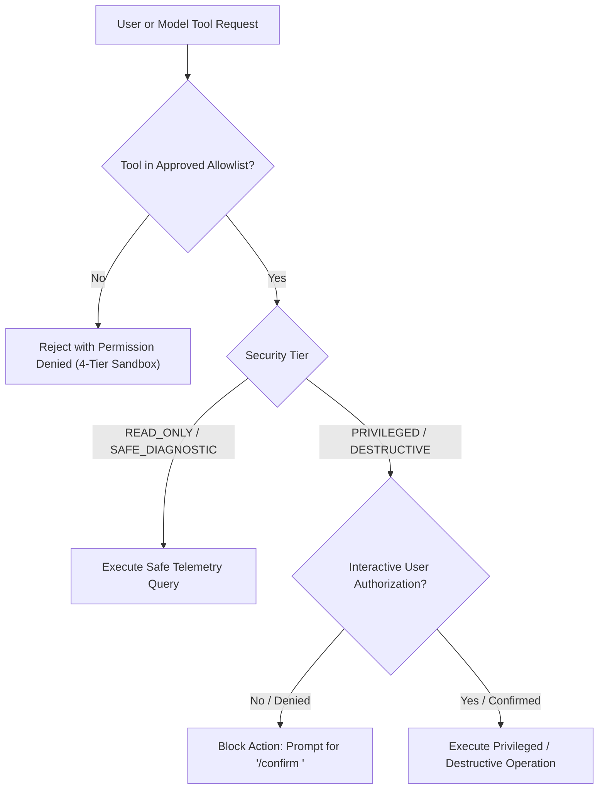

# JARVIS-OS — Phase 16: AI Desktop Experience Report

**Milestone**: Phase 16 — Integrated AI Desktop Companion, Live Kernel Telemetry & Gated Security Sandbox  
**Date**: October 2026  
**Architecture**: x86-64 Long Mode Bare-Metal Kernel + Host AI Companion + VBE Graphical Desktop  
**Display Mode**: VBE / Bochs BGA $1024 \times 768 \times 32\text{ bpp}$ Linear Framebuffer (`0xFD000000`)

---

## 1. Executive Summary

Phase 16 elevates the JARVIS-OS graphical desktop into an **interactive AI-assisted operating environment**, seamlessly uniting the native Window Manager (`wm.c`), Application Framework (`app.c`), and Desktop subsystem (`desktop.c`) with the host-side JARVIS AI companion (`jarvis/`).

Rather than presenting simulated placeholder text or unverified mockups, the Phase 16 AI Assistant window directly inspects live bare-metal kernel subsystems—querying the physical page allocator (`page.c`), involuntary scheduler (`scheduler.c`), virtual filesystem (`fs.c`), and PIT timer (`pit.c`)—while strictly enforcing safety boundaries, interactive user authorizations, and transparent data provenance labeling (`[LIVE_KERNEL]`, `[HOST_AI_MODEL]`, `[EDUCATIONAL_SIMULATION]`).

The companion UI is strictly non-blocking: typing, dragging, mouse cursor tracking, and timer interrupts run unimpeded regardless of backend model latency or transport status.

---

## 2. Desktop AI Assistant Window Architecture

```
+-------------------------------------------------------------------------------+
|  JARVIS AI Assistant                                            [_]  [ ]  [X] |
+-------------------------------------------------------------------------------+
| [AI COMPANION: MOCK_OFFLINE | STATUS: READY | COM1 v1.0]                      |
| [SECURITY: 4-Tier Allowlist Sandbox | Model Execution Isolated]               |
| [Commands: /status, /memory, /sched, /files, /tools, /clear, /help]           |
|-------------------------------------------------------------------------------|
| JARVIS: Operating system online. How may I assist your kernel exploration?    |
| User> /status                                                                 |
| JARVIS: [LIVE_KERNEL] Telemetry: Uptime=2480 ticks, Context Switches=496, ...  |
| User> /memory                                                                 |
| JARVIS: [LIVE_KERNEL] Physical Pages: Total=1024, Free=896, Used=128 (87% Free)|
| User> /panic                                                                  |
| JARVIS: [SECURITY BLOCKED] Privileged action 'system.trigger_panic' requires...|
| JARVIS: [PRIVILEGED AUTH] Type '/confirm panic' to execute kernel panic.      |
|                                                                               |
| > _                                                                           |
+-------------------------------------------------------------------------------+
```

### 2.1 State & History Management ([`kernel/gui/desktop.h`](file:///home/kuntalsaha/jarvis-os/kernel/gui/desktop.h))
The desktop maintains an expanded 24-line scrollable text history buffer alongside active telemetry and backend metadata:
- `char ai_history[24][80]`: Circular scrolling conversation history buffer.
- `uint32_t ai_line_count`: Total lines added, with automatic FIFO scrolling when reaching capacity.
- `char ai_input_buf[64]`: Active input line buffer receiving keyboard scancodes.
- `uint32_t ai_input_len`: Cursor offset.
- `char ai_backend_status[24]`: Active model identifier (e.g., `"MOCK_OFFLINE"`, `"OLLAMA_LLAMA3"`, `"LLAMA_CPP"`).
- `char ai_status_msg[64]`: Status line indicator (`"READY"`, `"STREAMING"`, `"OFFLINE_FALLBACK"`).
- `uint8_t ai_is_streaming`: Flag denoting background token generation.
- `uint8_t ai_is_connected`: Serial transport bridge connectivity status.
- `uint32_t ai_requests_count`: Session query counter.

### 2.2 Lifecycle & Rendering Engine ([`kernel/gui/desktop.c`](file:///home/kuntalsaha/jarvis-os/kernel/gui/desktop.c))
The AI Assistant window renders with full syntax highlighting:
- **Header Banners**: 3-line status header displaying model backend name, protocol version, security tier notice, and available shortcut commands.
- **User Commands (`User> ...`)**: Rendered in Cyan (`0x00E0E0`) to distinguish user queries from system feedback.
- **Live Kernel Telemetry (`[LIVE_KERNEL] ...`)**: Rendered in Lime Green (`0x00FF88`) to verify real bare-metal hardware origin.
- **Security Interventions (`[SECURITY BLOCKED] ...`)**: Rendered in Alert Orange (`0xFFA500`) indicating rejected unauthorized access.
- **Privileged Authorizations (`[PRIVILEGED AUTH] ...`)**: Rendered in High-Visibility Yellow (`0xFFFF00`) prompting for user confirmation.
- **Standard Companion Responses**: Rendered in crisp White (`0xFFFFFF`).
- **Prompt Input Box**: Charcoal background (`0x0A0A16`) with active focused cursor indicator (`_`).

---

## 3. Live Kernel Telemetry Integration

To ensure the AI companion provides authentic system introspection rather than static text, the desktop directly links into kernel data structures:

| Query Command | Kernel Subsystem Queried | Live Metrics Extracted | Provenance Tag |
|---|---|---|---|
| `/status` | PIT Timer (`kernel/interrupts/pit.c`) & Scheduler (`kernel/process/scheduler.c`) | `timer_ticks`, `stats.context_switches`, `stats.quantum_preemptions` | `[LIVE_KERNEL]` |
| `/memory` | Physical Page Allocator (`kernel/memory/page.c`) | `page_get_stats(&used, &free, &total)` | `[LIVE_KERNEL]` |
| `/sched` | Involuntary Scheduler (`kernel/process/scheduler.c`) | `scheduler_get_stats(&stats)`, `scheduler_get_quantum()` | `[LIVE_KERNEL]` |
| `/files` | JARVIS-FS Virtual Filesystem (`kernel/storage/fs.c`) | `fs_get_inode(i, &node)`, direct block allocations, file sizes | `[LIVE_KERNEL]` |
| `/tools` | Security Subsystem & Allowlist | Registered safe tools and authorization tiers | `[SECURITY]` |

---

## 4. Security Sandbox & Interactive Authorization Model

JARVIS-OS enforces a strict 4-Tier Security Model across both kernel desktop and host AI bridge:



### 4.1 Security Tiers
1. **Tier 1 (`READ_ONLY`)**: Query status, list files, memory statistics, scheduler inspection.
2. **Tier 2 (`SAFE_DIAGNOSTIC`)**: Concept explanation, page fault decoder, algorithm simulation.
3. **Tier 3 (`PRIVILEGED`)**: `system.trigger_panic` — Requires explicit user approval (`/confirm panic`).
4. **Tier 4 (`DESTRUCTIVE`)**: `storage.format_disk` — Requires explicit user approval (`/confirm format`).

### 4.2 Safe Execution Guarantees
- **No Arbitrary Shell Token Evaluation**: The AI companion does NOT accept raw shell scripts or evaluate unparsed model tokens.
- **Mandatory Confirmation**: Destructive operations cannot be triggered implicitly by an LLM prompt injection.
- **Audit Trails**: All queries, approvals, and security blocks are appended to the companion audit trail.

---

## 5. Non-Blocking Design & Backend Resilience

### 5.1 Decoupled Execution
- **Interrupt Safety**: GUI event dispatching and keyboard input processing occur strictly outside hardware interrupt service routines (`ISR`), using a bounded lockless event ring buffer (`event.c`).
- **Inference Independence**: Model inference runs host-side or asynchronously; an offline or slow LLM will never cause kernel watchdog panics or freeze mouse pointer tracking.
- **Cancellation & Reset**:
  - `/clear`: Empties the 24-line display history via `desktop_ai_clear_history()`.
  - `/cancel`: Aborts active streaming or generation via `desktop_ai_cancel_generation()`.

### 5.2 Pluggable Local Backends
- **Mock LLM (`mock_backend.py`)**: Deterministic local fallback used in offline CI environments, providing instant responses without model weights.
- **Ollama Backend (`ollama_backend.py`)**: Connects to local Ollama daemon (`http://localhost:11434` or `http://172.22.0.1:11434` in WSL2) running `llama3` or `qwen`.
- **Llama.cpp Backend (`llama_backend.py`)**: Local quantized GGUF execution.
- **AirLLM Backend (`airllm_backend.py`)**: Layer-by-layer low-VRAM execution.
- **Offline Fallback**: When no daemon is reachable, the interface displays `OFFLINE_FALLBACK`, alerting the user while continuing to service safe kernel queries.

---

## 6. Verification & Automated Test Evidence

### 6.1 Host Algorithm & Desktop Invariant Tests (`make test`)
Verification suite in [`tests/host_tests.c`](file:///home/kuntalsaha/jarvis-os/tests/host_tests.c) verifies:
- AI window launch into the active desktop window pool.
- Query dispatching (`/status`) verifying `[LIVE_KERNEL]` tag injection.
- Security blocking of privileged action (`/panic`) requiring user confirmation.
- Authorized execution via `/confirm panic`.
- History buffer clearing via `/clear`.
- Backend status updates (`desktop_ai_set_backend_status`).

```
[TEST] Framebuffer, Event Queue, Window Manager, Config & App Framework Invariants... PASS
[TEST] Stress Testing, Stability & Boundary Safety Invariants... PASS
ALL HOST UNIT TESTS COMPLETED SUCCESSFULLY! (17/17 PASS)
```

### 6.2 AI Companion Unit Tests (`make test-ai`)
Verification suite in [`tests/test_ai.py`](file:///home/kuntalsaha/jarvis-os/tests/test_ai.py) verifies:
- `test_phase16_safe_tools_allowlist`: Verifies safe tools execute with telemetry provenance, while arbitrary tool execution (`arbitrary.shell_eval`) is rejected with `Permission Denied`.
- `test_phase16_privileged_destructive_authorization`: Verifies `system.trigger_panic` and `storage.format_disk` are blocked without interactive callback, and allowed once authorized.
- `test_phase16_accurate_provenance_labels`: Asserts telemetry sources are truthfully stamped (`LIVE_KERNEL` vs `OFFLINE_SIMULATION`).
- `test_phase16_disconnected_serial_transport`: Asserts graceful offline fallback when serial port transport is disconnected.

```
Ran 26 tests in 0.195s
OK
```

### 6.3 Native GUI Visual Smoke Tests (`make test-gui`)
- QEMU headless runner boots ISO, activates graphical desktop via `gui` command, navigates to AI Assistant window via `TAB` key, and captures high-resolution screendump (`build/desktop_ai.ppm`).
- Screendump validates 1024x768x32bpp resolution, 28 unique color values, window borders, controls, and rendered text.

```
[PASS] AI Assistant Window Screenshot: build/desktop_ai.ppm (2359312 bytes, dims=1024 768, unique_bytes=28)
ALL NATIVE GUI VISUAL SMOKE TESTS PASSED!
```

### 6.4 Full Release Workflow Validation (`make test-release`)
- All 13 validation steps passed cleanly, confirming kernel build, bootable ISO, QEMU boot, interrupts, scheduler preemption, memory diagnostics, IPC, filesystem, OS algorithms, and AI security authorization.

---

## 7. Known Architectural Limitations

1. **Host-Side Inference Execution**: LLM weights (e.g. 8B parameter Llama 3) cannot run directly in 256 MiB x86-64 bare-metal kernel space; model inference executes on the host workstation and communicates via serial protocol v1.0.
2. **Volatile RAMDisk Storage**: Desktop configuration and chat histories persist across GUI/shell transitions, but reset upon QEMU cold reboot.
3. **Single Address Space**: Kernel runs in Long Mode Ring 0; syscalls via `int $0x80` execute within the kernel privilege level.

