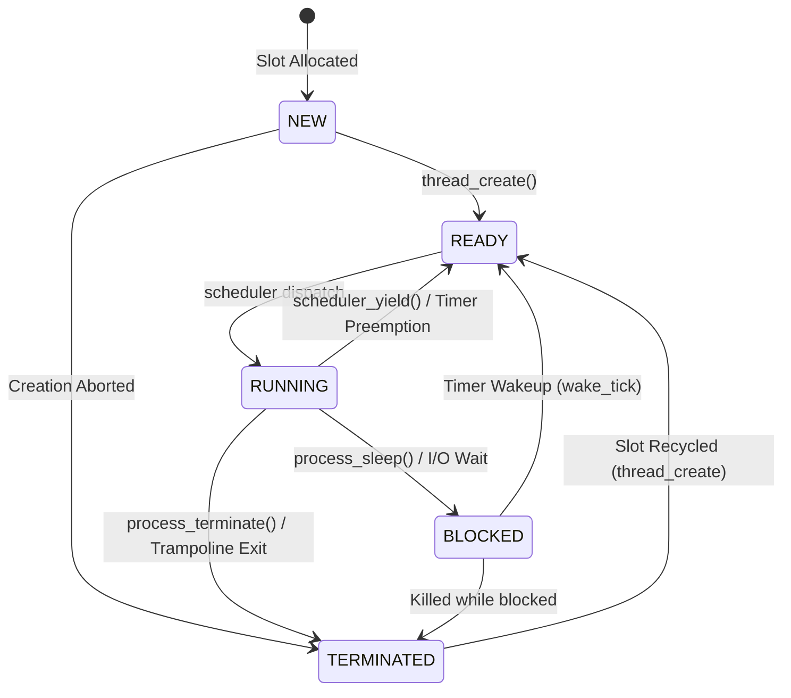

# JARVIS-OS — Phase 3 Process and Memory Correctness Verification Document

This document records the design, implementation, and verified execution evidence for **Phase 3 (Process and Memory Correctness)** of JARVIS-OS.

---

## 1. Phase 3 Completion Checklist (6/6 Completed)

| Requirement | Priority | Status | Implementation Details | Verified Evidence |
|---|---|:---:|---|---|
| **Context Switching Audit** | Critical | ✅ Complete | Verified 20-quadword frame (15 GPRs + 5 IRETQ fields = 160 bytes) in `kernel/interrupts/interrupts.S`. Conforms to AMD64 Long Mode 5-field `iretq` semantics and System V ABI stack alignment (`%rsp % 16 == 8` on entry). | Register & stack integrity test: PASS. Context-switch test: returned to kernel. |
| **Scheduler Correctness & State Machine** | Critical | ✅ Complete | Added `process_is_valid_transition` in `kernel/process/process.c`. Added dedicated idle task (PID 0) executing `sti; hlt`. Updated `scheduler_select_next` to prioritize user tasks (PIDs 1..N) and only idle when blocked tasks await timer wakeups. | State machine invariants verified in host tests. No starvation of runnable tasks. |
| **Register & Stack Integrity Test** | Critical | ✅ Complete | Tasks `reg_test_task_1` and `reg_test_task_2` in `kernel/kernel.c` load distinctive values into callee-saved registers (`%rbx, %r12, %r13, %r14, %r15`) and stack canaries, yielding across multiple iterations. | Output: `Register/stack integrity test: PASS (callee-saved regs & stack canaries preserved)` |
| **Page Allocator Invariants & Statistics** | High | ✅ Complete | Added `page_stats_t`, `page_get_stats()`, and `test_page_allocator_invariants()` in `kernel/memory/page.c` verifying 64-page exhaustion, double-free rejection, out-of-bounds rejection, pointer alignment, and pool restoration. | Boot output: `Page allocator invariants: PASS (64-page pool, bounds, double-free, alignment)`. Shell `memory` command reports live statistics. |
| **Safe Page-Fault Diagnostics & Decoder** | High | ✅ Complete | Added `page_fault_info_t`, `page_fault_decode()`, `page_fault_diagnose()`, and `test_page_fault_diagnostics()` in `kernel/interrupts/idt.c`. Decodes P, W/R, U/S, RSVD, I/D bits and distinguishes the 2 MiB identity-mapped boundary (`< 0x00200000`) from unmapped address space. | Boot output: `Page fault diagnostics: PASS`. Shell `pftest` command executes self-test and prints diagnostic output. |
| **Automated Regression Suite** | High | ✅ Complete | Expanded `tests/host_tests.c` (9 unit test suites), `scripts/qemu_smoke_test.py` (46/46 checkpoints passed), and verified `make test-all`. | 100% test pass rate across host unit tests, AI companion tests, and bare-metal QEMU execution. |

---

## 2. Process Context Switching Correctness

### 2.1 x86-64 IRETQ Frame Semantics
In 32-bit x86 Protected Mode, the `iretd` instruction only pops `ESP` and `SS` if a privilege level transition occurs (`CPL < RPL`). However, in **x86-64 Long Mode (AMD64)**:
1. The CPU **always pushes 5 quadwords** onto the interrupt stack regardless of privilege transitions:
   - `SS` (Stack Segment, offset 19)
   - `RSP` (Stack Pointer, offset 18)
   - `RFLAGS` (CPU Flags, offset 17)
   - `CS` (Code Segment, offset 16)
   - `RIP` (Instruction Pointer, offset 15)
2. The `iretq` instruction **always pops all 5 quadwords** back into the CPU registers, even for Ring 0 -> Ring 0 returns.
3. Therefore, constructing a full 20-quadword frame (15 GPRs + 5 IRETQ fields = 160 bytes) is mandatory for kernel-mode tasks.

```
+------------------------------------+ <-- Initial RSP (16-byte aligned - 8)
| SS (0x10)                          | Frame[19] (+152)
| RSP (Stack Top)                    | Frame[18] (+144)
| RFLAGS (0x202, IF=1)               | Frame[17] (+136)
| CS (0x08)                          | Frame[16] (+128)
| RIP (Entry / Trampoline)           | Frame[15] (+120)
+------------------------------------+
| RAX                                | Frame[14] (+112)
| RBX                                | Frame[13] (+104)
| RCX                                | Frame[12] (+96)
| RDX                                | Frame[11] (+88)
| RBP                                | Frame[10] (+80)
| RSI                                | Frame[9]  (+72)
| RDI (Task Arg)                     | Frame[8]  (+64)
| R8                                 | Frame[7]  (+56)
| R9                                 | Frame[6]  (+48)
| R10                                | Frame[5]  (+40)
| R11                                | Frame[4]  (+32)
| R12                                | Frame[3]  (+24)
| R13                                | Frame[2]  (+16)
| R14                                | Frame[1]  (+8)
| R15                                | Frame[0]  (+0)
+------------------------------------+ <-- Saved RSP (points to R15)
```

### 2.2 System V AMD64 ABI Stack Alignment
The AMD64 System V ABI mandates:
- The end of the stack argument area must be 16-byte aligned immediately before a `call` instruction.
- At the entry point of a function, `(%rsp + 8)` is a multiple of 16 (i.e., `%rsp % 16 == 8`), because `call` pushes an 8-byte return address.
- In `thread_create()`, stack initialization computes:
  ```c
  uintptr_t top = (uintptr_t)&process_stacks[i][PROCESS_STACK_SIZE];
  top = (top & ~(uintptr_t)0xF) - 8;
  ```
- When `iretq` pops `RSP = top`, the entry function starts with `%rsp % 16 == 8`. Standard function prologues (`push %rbp; mov %rsp, %rbp`) then bring `%rsp` to 16-byte alignment before subsequent function calls.

### 2.3 Task Trampoline and Clean Termination
Each user thread enters via `process_task_trampoline()`:
```c
void process_task_trampoline(void)
{
    process_t *p = scheduler_current_process();
    if (p != 0) {
        void (*entry)(void *) = (void (*)(void *))(uintptr_t)p->entry_point;
        entry(p->arg);
        process_terminate(p->pid);
    }

    scheduler_yield();
    for (;;)
        __asm__ volatile ("cli; hlt");
}
```
When `entry()` completes, the trampoline explicitly transitions the task to `PROCESS_TERMINATED` and yields. The scheduler detects that no further ready tasks exist, frees the thread slot, and returns cleanly to `bootstrap_frame` in `kernel_main`.

---

## 3. Scheduling Correctness & State Machine

### 3.1 Process State Transition Rules
The process lifecycle is strictly governed by `process_is_valid_transition(from, to)` in `kernel/process/process.c`:



Direct illegal transitions are blocked:
- `NEW -> RUNNING`: Illegal (tasks must enter the `READY` queue first).
- `READY -> BLOCKED`: Illegal (a task cannot block without executing).
- `BLOCKED -> RUNNING`: Illegal (a task must transition through `READY` first).

### 3.2 Dedicated Idle Task (PID 0) & Non-Starvation
1. **PID 0 Creation**:
   - `process_init()` initializes `process_table[0]` as the kernel idle task (`pid = 0`, priority 0) running `idle_task_entry()` (`for (;;) { __asm__ volatile ("sti; hlt"); }`).
   - User tasks are assigned PIDs starting at index 1 (`pid >= 1`).
2. **Scheduling Policy**:
   - `scheduler_select_next()` first sweeps user tasks (indices `1 .. MAX_PROCESSES - 1`).
   - If runnable user tasks exist, the idle task is **never** selected.
   - If all user tasks are blocked (e.g. sleeping via `process_sleep`), `scheduler_select_next()` dispatches PID 0, placing the CPU into a power-saving halt state until the next PIT timer interrupt wakes up sleeping tasks.
   - If all user tasks are terminated and none are blocked, the scheduler returns `NULL`, triggering the restoration of `bootstrap_frame` to return to `kernel_main`.

---

## 4. Memory Management & Invariants

### 4.1 Page Allocator Invariants
The physical page allocator manages 64 pages (256 KiB pool) using a 64-bit bitmap (`page_bitmap`):
- **Pool Size**: 64 physical pages $\times$ 4096 bytes = 262,144 bytes (256 KiB).
- **Invariants Verified by `test_page_allocator_invariants()`**:
  1. Exhaustion handling: Allocates all 64 pages; 65th allocation returns `NULL`.
  2. Double-free rejection: Freeing an already freed page returns `-1`.
  3. Out-of-bounds rejection: Freeing addresses below `pool_base` or above `pool_end` returns `-1`.
  4. Misalignment rejection: Freeing a pointer not aligned to 4096 bytes returns `-1`.
  5. NULL rejection: `page_free(NULL)` returns `-1`.
  6. Clean pool restoration: Freeing all 64 pages returns `page_free_count() == 64`.

### 4.2 Page Fault Diagnostics & Memory Boundaries
The bootloader maps the first 2 MiB of physical memory using a 2 MiB Huge Page (`PD[0]`, PS=1, R/W=1, P=1). Any virtual memory address $\ge$ 2 MiB (`0x00200000`) is unmapped.

`page_fault_decode()` decomposes the architectural `#PF` error code:
- **Bit 0 (P)**: 0 = Page not present; 1 = Protection violation.
- **Bit 1 (W/R)**: 0 = Read access; 1 = Write access.
- **Bit 2 (U/S)**: 0 = Supervisor mode (Ring 0); 1 = User mode (Ring 3).
- **Bit 3 (RSVD)**: 1 = Reserved bit violation in page directory entry.
- **Bit 4 (I/D)**: 1 = Fault occurred during instruction fetch.
- **Region Boundary**: Distinguishes identity-mapped memory (`< 0x00200000`) from unmapped address space (`>= 0x00200000`).

---

## 5. Verification Evidence

### 5.1 Host Unit Test Suite (`make test`)
```
==================================================
   JARVIS-OS HOST ALGORITHM VERIFICATION SUITE    
==================================================
[TEST] CPU Scheduling Algorithms... PASS
[TEST] Page Replacement & Belady Anomaly... PASS
[TEST] Banker's Deadlock Avoidance... PASS
[TEST] Disk Head Scheduling (FCFS, SSTF, SCAN, C-SCAN)... PASS
[TEST] Memory Allocation Fit (First, Best, Worst)... PASS
[TEST] File Allocation Methods (Contiguous, Linked, Indexed)... PASS
[TEST] Deadlock Detection (WFG/Matrix) & Prevention... PASS
[TEST] Process Lifecycle State Transitions... PASS
[TEST] Memory Boundary & Frame Invariants... PASS
==================================================
   ALL HOST UNIT TESTS COMPLETED SUCCESSFULLY!    
==================================================
```

### 5.2 AI Companion Test Suite (`make test-ai`)
```
python3 -m unittest discover -s tests -p "test_*.py"
..........
----------------------------------------------------------------------
Ran 10 tests in 0.002s

OK
```

### 5.3 Automated QEMU Smoke Test (`scripts/qemu_smoke_test.py`)
```
==================================================
      JARVIS-OS AUTOMATED QEMU SMOKE TEST         
==================================================
Captured 13897 bytes of serial output in 12.01s.

  [PASS] Early Serial Debug Output
  [PASS] Multiboot 0.6.96 Hand-off
  [PASS] Physical Memory Discovery
  [PASS] BIOS/GRUB Memory Map
  [PASS] Page Allocator Test
  [PASS] Page Allocator Invariants
  [PASS] Page Fault Diagnostics Boot
  [PASS] RAM Disk Test
  [PASS] Cooperative Switching
  [PASS] Cooperative Return
  [PASS] Register/Stack Integrity Test
  [PASS] Timer Preemption Execution
  [PASS] Timer Preemption Quanta Switch
  [PASS] Timer Preemption Verified
  [PASS] Kernel Online
  [PASS] Shell Ready
  [PASS] Interrupt Subsystem IRQ0/1
  [PASS] Timer IRQ0 Vector
  [PASS] Keyboard IRQ1 Vector
  [PASS] Process & Thread Metrics
  [PASS] Memory Subsystem Boundary
  [PASS] Page Fault Decoder Self-Test
  [PASS] Page Fault Diagnosis Output
  [PASS] Context Switch Counting
  [PASS] Quantum Preemption Counting
  [PASS] Directory Listing (ls)
  [PASS] File Readback (cat)
  [PASS] CPU Scheduling Simulation
  [PASS] Page Replacement Benchmark
  [PASS] Belady's Anomaly
  [PASS] Memory Allocation Fit Benchmark
  [PASS] Best Fit Allocs
  [PASS] File Allocation Methods Benchmark
  [PASS] File Allocation Lookup
  [PASS] Banker's Deadlock Avoidance
  [PASS] Banker Safe Sequence
  [PASS] Deadlock Detection & Prevention
  [PASS] Deadlock Detection Cycle Found
  [PASS] Deadlock Prevention Havender
  [PASS] Disk Scheduling Simulation
  [PASS] Synchronization Invariants
  [PASS] Producer-Consumer Invariant
  [PASS] Reader-Writer Invariant
  [PASS] JARVIS-FS Directory
  [PASS] Software Interrupt Syscall
  [PASS] Syscall int $0x80 Execution

==================================================
   ALL 46 VERIFICATION CHECKPOINTS PASSED!       
==================================================
```

---

## 6. Architectural Boundaries and Limitations

1. **Privilege Levels**: All kernel tasks run at Ring 0 (CPL=0). Although the `iretq` frame fully preserves all 5 fields (`RIP, CS, RFLAGS, RSP, SS`), user-mode tasks (Ring 3) with separate address spaces are not yet implemented.
2. **Memory Paging**: Paging is configured as a single 2 MiB identity-mapped page table (`0x00000000 - 0x001FFFFF`). Demand paging, copy-on-write, and per-process virtual address spaces are educational simulations in `kernel/algorithms/page_replace.c`, not active MMU hardware mappings.
3. **Task Isolation**: Because all tasks share the kernel address space, stack overflow protection is implemented via canary checks rather than MMU guard pages.
